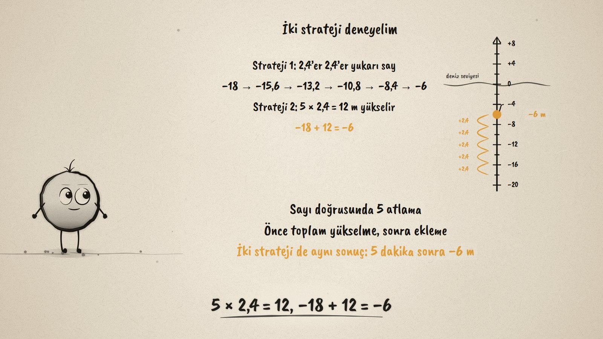
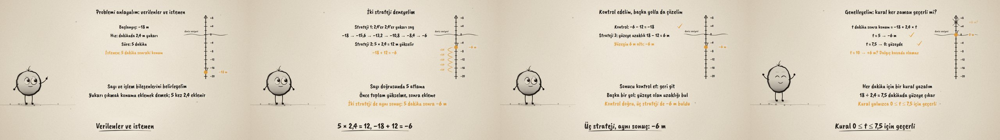

# Dalgıç Yüzeye · Problems with Rational Numbers

**▶ Tarayıcıda izleyin / Watch in the browser:** https://hakanatas.github.io/dalgic-yuzeye/ 
**⬇ MP4 + altyazılar / MP4 + subtitles:** [Releases](https://github.com/hakanatas/dalgic-yuzeye/releases) 
**✎ Kullanılan istem / The prompt behind it:** [PROMPT.md](PROMPT.md) 
**🎞 Bütün filmler / All films:** [Nokta'nın Filmleri](https://hakanatas.github.io/nokta-filmleri/?sinif=7)

> **TR —** 7. sınıf matematik "Sayılar ve Nicelikler (1)" temasındaki MAT.7.1.4 öğrenme çıktısı için hazırlanmış, tamamen JavaScript ile çizilen 92 saniyelik mürekkep animasyonu. Bir dalgıç deniz seviyesinin 18 m altında (−18 m) ve dakikada 2,4 m yükseliyor: 5 dakika sonra nerede? Problemin bileşenleri ayrılıyor (başlangıç, hız, süre, istenen) ve seçilecek işlemle ilişkilendiriliyor: yeni konum = −18 + 5 × 2,4. Durum dikey bir sayı doğrusuyla temsil ediliyor. Birinci strateji 2,4'er 2,4'er yukarı sayıyor (−15,6; −13,2; −10,8; −8,4; −6), ikinci strateji önce toplam yükselmeyi buluyor (5 × 2,4 = 12, −18 + 12 = −6). Sonuç geri gidilerek kontrol ediliyor (−6 − 12 = −18) ve üçüncü bir yolla (yüzeye uzaklık 18 − 12 = 6 m) yeniden bulunuyor. Son olarak kural genelleniyor (konum = −18 + 2,4 × t) ve sınanıyor: 7,5 dakikada yüzeye çıkılır, t = 10 için +6 m anlamsızdır; kural yalnızca 0 ≤ t ≤ 7,5 için geçerlidir. Altyazılar Türkçe, İngilizce ya da ikisi birlikte seçilebilir.

A 92-second ink animation for **7th-grade maths**. Nokta, the ink character from [The Learning Ink](https://github.com/hakanatas/the-learning-ink), is the guide again. The diver's depth is a function of time (`depth` in `scenes/scene1.js`), so the hops, the rise to the surface and the impossible ghost at +6 m all come from the same rule the film ends with.

## Learning outcome

MEB, Türkiye Yüzyılı Maarif Modeli, Ortaokul Matematik, 7th grade, "Sayılar ve Nicelikler (1)" theme:

**MAT.7.1.4. Rasyonel sayılar ve işlemler içeren gerçek yaşam problemlerini çözebilme**
- a) Rasyonel sayılarla toplama, çıkarma, çarpma ve bölme işlemlerini içeren problemlerde sayı ve işlem bileşenlerini belirler.
- b) Rasyonel sayılarla toplama, çıkarma, çarpma ve bölme işlemlerini içeren problemlerde istenenler ve seçilen işlemler arasındaki ilişkileri belirler.
- c) Rasyonel sayılarla toplama, çıkarma, çarpma ve bölme işlemlerini içeren problemlerde problem bağlamını uygun temsillere (şekil, sayı doğrusu gibi) dönüştürür.
- ç) Kullanılan temsil üzerinden problemi kendi ifadeleri ile açıklar.
- d) Problemlerin çözümü için stratejiler oluşturur.
- e) Stratejileri işe koşarak problemi çözer.
- f) Problemin çözümünü kontrol eder.
- g) Problemlerin olası farklı çözüm stratejilerini inceler.
- ğ) Çözüme ulaştıran stratejilere uygun genellemeler yapar.
- h) Genellemelerin geçerliliğini değerlendirir.

## Scenes

| # | Time | Scene | What happens | Outcome |
|---|---|---|---|---|
| 1 | 0–10 s | Dalgıç | At −18 m, rising 2.4 m a minute: where after 5 minutes? | a |
| 2 | 10–28 s | Problemi anla | Start, speed, time, what is asked; new position = −18 + 5 × 2.4. | a, b, c, ç |
| 3 | 28–46 s | Stratejiler | Five hops of 2.4 on a vertical number line; 5 × 2.4 = 12, −18 + 12 = −6. | d, e |
| 4 | 46–64 s | Kontrol | −6 − 12 = −18; the distance to the surface, 18 − 12 = 6 m. | f, g |
| 5 | 64–80 s | Genelleme | Position = −18 + 2.4 × t; surface after 7.5 minutes; t = 10 makes no sense. | ğ, h |
| 6 | 80–92 s | Aklında kalsın | Understand, represent, solve, check, test the rule. | a–h |

## Running it

- **Preview:** double-click `index.html` (it works offline).
- **MP4:** run `npm install` once, then `npm run export -- --format=horizontal --captions=tr`.
- **Subtitles and narration:** `npm run srt` writes `out/captions_*.srt` and `narration_notes.txt`.
- **Editing:**
  - Caption text, timings and narration notes: `captions.js`
  - Everything on screen is drawn by `LI.world(t)` in `scenes/scene1.js` (the depth line, the diver, the working, the words); the other scenes only set the camera.
  - Nokta's poses: `src/draw/film.js`; layout for 16:9 and 9:16: `src/draw/kd.js`

It uses the same engine as The Learning Ink: `renderFrame(t)` as a pure function of time, seeded randomness, and frame-by-frame export.
